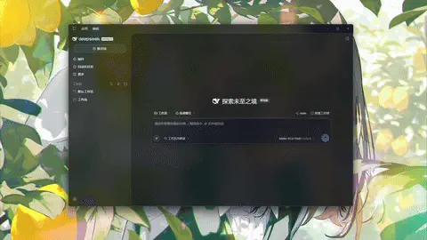

# 魔理沙UI

> DeepSeek Harness 网页端的极光玻璃主题插件（`dsh-marisa-ui-plugin`）

## 预览




## 安装

```powershell
dsh plugin --profile web add dsh-marisa-ui-plugin
```

- **窗口玻璃注入仅 Windows**（需改写安装目录 `app.asar`）

## 适配版本

| 组件 | 版本 |
| --- | --- |
| DeepSeek Harness | 0.2.2-rc3 |
| 插件 | v1.12.3 |
| `@deepseek-ai/cordis`（peerDependency） | `~4.1.0` |
| 运行时（桌面端） | Electron 44.7.0 |


## Star

[](https://star-history.com/#LanluZ/dsh-marisa-ui-plugin&Date)

## 许可证

MIT
